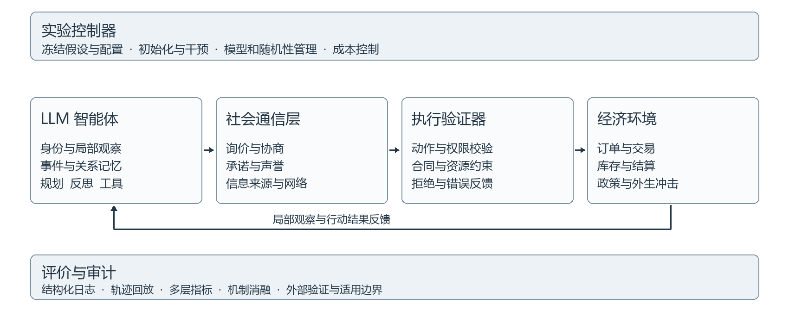

# 基于大语言模型的可信多智能体社会经济系统仿真

2026 年研究进展与项目设计

调研截止日期 2026 年 9 月 28 日

## 摘要

本项目适合定位为面向社会经济场景的 LLM-based multi-agent system 研究：以具有持续身份、记忆、目标、工具使用和社会交互能力的语言智能体为基本单元，研究它们如何通过沟通、协商、交易和制度适应形成群体行为，并建立可复现、可审计、可校准的实验方法。项目的核心贡献应落在智能体机制与多智能体交互上，社会经济环境负责提供资源约束、反馈和可测量结果。

截至调研截止日，领域已从 Generative Agents 的小规模社会生活演示，发展到 AgentSociety、OASIS 等大规模交互平台，以及 2026 年的 AgentSociety 2、AIvilization、CoffeeBench、Market-Bench 等研究环境和经济智能体基准。与此同时，SimBench、SUBJSIM 和有关行为异质性、因果识别的研究表明：语言流畅、角色可信、指标拟合与现实有效性是不同层次的问题，不能互相替代。[3,7–8,14,16,21,23–26,29]

建议把项目主线收敛为：在社会沟通与交易相互耦合的市场中，研究 LLM 智能体的记忆、信任更新和通信结构如何影响长期合作、资源分配与系统风险，以及制度干预能否在不同模型和环境下保持效果。先建立一个规模可控、具有完整交易记录的多智能体市场，再逐步扩展人口与场景。第一阶段优先回答 AI 智能体群体自身的机制问题；若要解释人类社会或预测真实政策效果，再增加独立的人类行为数据与外部验证。

本报告把已有文献结论与拟议研究方案分别表述。后文中的实验规模、预算、里程碑和验收条件均为设计建议，不代表项目已经实现的结果。

## 一 研究范围与核心概念

### 1 为什么必须以 LLM agent 为研究单元

这里的 agent 不只是被提示“扮演消费者”的一次问答。一个完整的语言智能体应能够接收局部观察，检索自己的经历和关系，形成当前目标，选择可执行行动，调用工具改变环境，再根据反馈更新记忆与策略。ReAct 提供了推理与行动交替的基本范式，CoALA 将记忆、内部操作、外部行动和决策过程组织为认知架构，Generative Agents 展示了记忆检索、反思和规划对社会行为的重要性。[1–3]

多智能体系统则要求多个这样的行动主体具有各自的状态、信息和目标，并相互影响。仅让几个模型并行回答同一问题，或由一个大模型一次性生成整座城市的故事，都不足以构成可信的社会经济交互实验。系统应能明确回答：谁知道什么、谁能联系谁、谁能执行哪些操作、一次行动如何改变他人的机会与约束。

### 2 三类相邻问题需要分别评价

| 研究类型 | 智能体的角色 | 核心问题 | 主要证据 |
| --- | --- | --- | --- |
| 人类行为代理 | 近似特定人群或个体 | 能否重现人类行为分布及干预响应 | 独立人类数据和外部效度 |
| AI 智能体社会 | 自主的人工行动主体 | AI 群体如何形成规范、市场、合作与风险 | 控制实验、机制消融和跨模型复现 |
| 研究工作流多智能体 | 文献、设计、执行、分析助手 | 能否可靠地组织研究过程 | 方案正确性、执行完整性和人工审查 |

本项目应以第二类为主要起点，把第一类作为需要数据支持的拓展任务，把第三类作为辅助研究基础设施。已有综述分别梳理了个体至社会的模拟层次，以及多智能体的协作结构与协议，可用于组织相关工作。[19,20] AgentSociety 2 已把 AI 社会科学家与硅基参与者纳入同一运行环境，这也意味着新项目不能仅把“自动设计实验并生成报告”作为唯一创新点。[25]

传统规则模型、优化模型或强化学习模型在本报告中只承担三个角色：提供必要的环境约束；作为对照检验 LLM 的增量价值；帮助排查某种宏观现象是否完全由环境规则预先决定。它们不构成项目的主体技术路线。

### 3 调研方法与证据口径

本次采用广泛但非穷尽的专题调研，覆盖 agent 架构、社会仿真平台、经济交互、规范涌现、行为校准、可信性和研究自动化。以 arXiv 原始论文页与可用全文、ACL Anthology、期刊全文、会议官网、官方项目页及 Crossref 元数据交叉核查，检索入口和二手阅读清单仅用于发现候选文献。

文献时间按首次发布、后续修订与正式发表分别判断。2026 年的新工作与旧工作的 2026 年修订均纳入，但不将修订年份当成首次提出年份。会议立场论文、研讨会论文、预印本和工程项目页在参考文献中标明；它们提供不同性质的证据，不能一概视为已经独立复现的共识。

## 二 从架构演示到可执行的智能体社会

### 1 研究演进

2023 至 2024 年的关键进展是让 LLM 从静态文本生成器成为持续行动者。Generative Agents 以 25 个智能体展示日常活动、记忆、规划与信息传播；Concordia 引入组件化智能体与 Game Master，将语言行动映射到社会、物理或数字环境；SOTOPIA 则把社会交互能力转化为可评价任务。EconAgent 将感知和记忆机制应用于工作、消费与宏观活动。[3–6]

2024 至 2025 年，重点扩展到大规模社会交互、真实个体画像与专门基准。OASIS 将社交网络、推荐机制与多种社交动作结合；AgentSociety 将社会生活嵌入环境与仿真引擎；YuLan-OneSim 探索自然语言构建场景及研究流程自动化；SocioVerse 强调真实用户池与环境、用户、交互、行为的对齐。[7–10]

2026 年有三条值得本项目直接吸收的进展。第一，智能体经济研究开始关注跨企业、跨角色、长时程的工具操作，CoffeeBench 和 Market-Bench 是清晰例子。第二，AgentSociety 2 与 AIvilization 推进持续身份、可执行研究流程及长期自主行动。第三，SimBench、SALT 与边界研究把讨论从“看起来像人”推进到行为分布、异质性和可识别机制。[14,16,21,23–26]

### 2 代表性平台与工作比较

| 工作 | 已核实的主要能力 | 对本项目的价值 | 不能直接推出的结论 |
| --- | --- | --- | --- |
| Generative Agents [3] | 25 个智能体的记忆、反思、规划与社会生活 | 设计持续身份和社会记忆 | 角色可信不等于人口代表性 |
| Concordia [4] | 组件化 agent 与 Game Master 环境 | 开放社会行动和实验规则表达 | 语言裁判的判断不自动具备客观性 |
| EconAgent [6] | LLM 感知和记忆驱动工作、消费 | 连接个体决策与经济反馈 | 宏观拟合不等于政策预测有效 |
| OASIS [7] | 动态网络、推荐、社交动作；报告支持百万用户级模拟 | 信息扩散、网络暴露与群体效应 | 规模上限不等于百万独立真人样本 |
| AgentSociety [8] | 报告超过一万 agent、约五百万次交互；多种社会实验 | 社会沟通与经济环境耦合 | 案例对齐不等于跨制度普遍有效 |
| YuLan-OneSim [9] | 自然语言场景生成、反馈优化、AI researcher | 降低实验构建成本 | 自动生成的实验仍需审查 |
| SocioVerse [10] | 基于千万真实用户池的多方面对齐 | 人群初始化与画像数据设计 | 用户池规模不等于同时仿真规模 |
| AIvilization v0 [21] | 分层规划、双过程记忆、动态画像、人类引导 | 长期身份与自主行动 | 公开部署中的相关性不等于随机实验 |
| MALLES [22] | 交易数据后训练、消费者偏好、多角色讨论 | 数据支撑的经济决策校准 | 购买预测改善不等于一般社会机制成立 |
| CoffeeBench [23] | 六家异质企业、90 天交易与经营工具 | 长期协商、履约和现金流 | 固定对手下的排名不代表所有市场 |
| Market-Bench [24] | 采购竞价、定价、营销及完整账簿轨迹 | 语言策略与资源竞争联合评估 | 竞争集中不自动证明串谋 |
| AgentSociety 2 [25] | AI researcher 与硅基参与者共用研究运行环境 | 可追踪实验流程与能力模块化 | 自动研究流程不自动产生可靠因果证据 |

上述规模均为相应文献或项目报告的设定与能力描述，不是本报告重新运行后的测量。不同平台的 agent 活跃比例、推理频次、仿真时长与硬件条件不同，不能仅按 agent 数量比较研究价值。

## 三 2026 年值得重点吸收的研究方向

### 1 从静态角色设定到可持续的身份与记忆

角色描述提供初始条件，长期行为还取决于发生过什么、哪些经历被保留、谁被视为可信，以及目标如何变化。AIvilization 将短期执行轨迹与长期语义整合分开，并通过分层规划协调长期目标和局部可行性。它说明记忆和规划已成为大型人工社会的关键研究对象，而不是简单增加一段人物设定。[21]

本项目可区分事件记忆、关系记忆、承诺记忆和制度记忆。事件记忆记录实际经历；关系记忆记录对方的可靠性；承诺记忆记录报价、协议与履约期限；制度记忆记录当前有效规则。关于“对方不可信”的总结必须能够回溯到观察证据。需要研究的不是记忆越长越好，而是不同保留、遗忘与压缩策略如何影响承诺一致性、合作持续性和不实信息固化。

### 2 从人口标签到证据支持的异质性

Park 等关于个体模拟的研究在 2026 年更新了论文标题和结果表述。当前版本使用 1,052 名美国受访者的数据，以访谈、结构化问卷或两者共同构建 agent；在保留的 GSS 题目上，三种设置的准确率分别达到参与者自身两周重测一致性基准的 83%、82% 和 86%，人口属性提示为 74%。这些是相对于重测基准的比例，不是“模拟完整人类行为的正确率”。[13]

可借鉴的方向是用可追溯行为证据初始化偏好与经历，并在未参与初始化的任务上检验。仅改变年龄、职业或收入标签，不能证明存在有效行为异质性。不同模型也不宜直接映射为不同教育水平；已有多 LLM 政策框架尝试了这种映射，但对于本项目，这应被视为需要独立验证的假设。[18,30]

建议区分三种异质性：资源与经历不同，决策偏好与社会关系不同，底层模型与推理能力不同。实验时分别控制，避免把模型强弱误解释成人群差异。

### 3 从独立回答到真实相互依赖的经济交互

CoffeeBench 的六家企业分别扮演农场、烘焙商和零售商，在 90 个模拟日内发消息、报价、下单、付款与经营。官方实验将被测模型放在一家烘焙商，其余五家使用固定参考模型，每个被测设置运行三次。因此它提供了有价值的可执行经济任务，但对手分布与重复次数限制了结果的外推范围。项目还观察到持续分析却长期不行动的 idle-drift，提示长时程 agent 评估必须同时检查规划和实际执行。[23]

Market-Bench 将预算约束下的采购竞价、零售价格、营销语言及购买过程联系起来，并记录完整轨迹。作者在所测试的 20 个模型中报告明显差异及赢家占据大部分收益的现象。这为本项目提供了比“让 agent 描述经济决策”更强的实验形式：语言改变他人的认知或报价，工具调用改变资源与机会。[24]

GLEE 进一步提供语言经济博弈框架，分别评价个人收益、系统效率与公平性。它也表明环境参数与所用模型可能共同影响结果，因此评测不应只比较一张总利润排行榜。[12]

### 4 从个体安全到群体规范与系统风险

Ashery 等在 Science Advances 的工作研究语言智能体群体中的命名协调，展示了共享惯例、集体偏差与少数坚定行动者对规范变化的影响。其研究对象是 AI 群体本身，并非直接证明 LLM 可以替代人类被试。这一点与本项目强调 AI agent 和多智能体系统的定位高度一致。[11]

这里的“集体偏差”首先指对等价选择的群体偏好，不能未经验证就扩展为所有社会歧视。同样，市场中出现同步涨价，可能来自共同需求信号、同一模型的共同先验或显式沟通，不能立即认定为串谋。项目应通过断开通信、改变网络、替换对手、统一外生信息等干预，区分不同解释。

可以将“单个智能体在局部评价中合规，群体结果却产生集中、排斥或脆弱性”作为核心问题。2026 年的多模态社会仿真安全研究也显示，局部计划修正和整体安全之间可能存在落差；其特定基准上的结果应被用于设计压力测试，而非泛化为所有模型的失败率。[28]

### 5 从平均行为拟合到分布级评价

SimBench 汇集 20 个数据集，覆盖道德判断和经济选择等行为，论文页标明已被 ICLR 2026 接收。作者报告的最好综合分数为 40.80/100，并指出 instruction tuning 对低熵共识问题与高熵多样问题的影响可能不同。这个分数属于特定基准和模型集合，不能理解成“LLM 有 40.8% 的人类模拟能力”。[14]

2026 年 8 月的 SALT 工作进一步认为，主观行为的一次观察只是潜在响应分布的一个样本，单标签准确率和硬标签训练可能产生误导。其 SUBJSIM 基准包含 193 位标注者、100 个主观问题和 19,300 个情境；作者提出依据主观程度调整软标签聚合的方法。这是值得跟进的预印本方向，尚不能单独证明长期多智能体社会已经得到验证。[26]

因此，项目应同时报告均值、方差、分位数和条件分布，并检查少数行为模式是否被抹平。人类数据存在时评估分布校准；研究 AI 社会时，则检验群体多样性、路径依赖和制度响应的稳定性，不能把更像平均人自动当成更好。

### 6 从输出可信到机制可识别

2026 年的边界立场论文强调行为异质性与研究问题之间的匹配：均值相似，但方差不足时，某些依赖尾部群体或少数行动者的社会问题仍无法有效研究。[16]

另一个 2026 年 ICML 研讨会立场工作区分了预测吻合与机制识别：训练先验、提示诱导和真正的交互涌现可能生成相似结果。该工作属于方法论立场，不是证明所有 LLM 仿真都无效。它对项目的直接启发是：不能把一条熟悉的宏观曲线当成机制证据，应构造能区分不同解释的实验。[29]

例如，当市场在政策公告后恢复交易，应分别测试实际补贴变化、公告文本变化和二者结合的影响。若仅改写“刺激消费”措辞就出现预期结果，而预算和交易规则完全不变，可能主要测到了语言诱导。较乐观的方法论工作也强调迭代评价，并将试点与探索性研究作为当前的重要用途；这与严谨验证并不冲突。[17]

### 7 从封闭选择题到可测量的开放交流

EACL 2026 的开放性立场论文强调，自由文本可以揭示未预设的观点与理由，也能减少研究者通过选项施加的限制。但自由文本同时提高了测量难度。[27]

本项目适合保留开放沟通，并要求经济行动结构化。智能体可以自由协商、解释、质疑和建立关系；订单、支付、合同和政策执行则通过有类型的工具接口完成。语言证据和行为证据分别记录：说“愿意合作”、提交可接受报价、完成付款，是三个不同事件。

### 8 从仿真平台到可审计的研究流程

AgentSociety 2 将假设、环境、agent 行为、干预和测量整合为可执行研究流程，并报告七个示例研究。官方代码库还展示多种推理模式、模块化环境、回放与追踪能力。YuLan-OneSim 已探索自然语言场景构建和 AI 社会研究员。因此本项目宜复用合适的运行基础设施，将差异化贡献集中在可信交互机制和评估协议。[9,25,33]

研究助理 agent 可以生成实验草案和分析脚本，但不能根据测试结果反复修改假设后仍把结果称为预先验证。要冻结正式实验配置，区分探索集与确认集，并让分析程序读取结构化日志而非依赖 agent 的主观总结。

## 四 项目定位与可检验的创新方向

### 1 建议的项目表述

中文题目建议为“基于大语言模型的可信多智能体社会经济系统仿真”。若进一步强调论文主线，可使用“语言智能体社会中的信任传播与制度干预”。英文项目名称可调整为 Trustworthy Socioeconomic Simulation with LLM Based Multi Agent Systems。

核心目标是构建一个由 LLM 智能体持续行动和交互驱动的社会经济实验平台，揭示个体记忆、局部信息、社会通信和制度约束如何共同塑造合作、交易网络、资源分配与系统性风险，并提供能够支持结论复现和边界判断的证据。

### 2 优先考虑的三项研究贡献

第一项是证据约束的社会记忆与信任机制。将真实交互记录、第三方传闻和 agent 自身推断分开保存，研究可追溯记忆是否能减少失实声誉传播和长期承诺冲突，同时保留合理的行为多样性。创新不能只停留在“增加记忆库”，应明确记忆检索、来源权重或信任更新的可消融设计。

第二项是多智能体涌现的干预评价协议。通过通信边删除、消息内容重排、模型替换、记忆重置和制度变更，建立“观察到现象—提出机制—干预机制—检验跨条件复现”的研究链条。重点判断哪些结果依赖真实交互，哪些主要来自共同先验或实验脚本。

第三项是制度约束与行为多样性之间的可测量权衡。比较不同的信息披露、交易担保、审计反馈或资源政策，评估它们是否改善履约与系统稳定性，又是否导致过度保守、行为同质化或资源集中。制度的有效性是待检验命题，不能预先写入 agent 的目标提示。

这三项可以组合成一个项目，但一篇首发论文宜选择其中一项作为主要贡献，其余作为支撑。是否构成新的学术贡献，还需在最终算法与实验设定确定后进一步做针对性查新。

### 3 建议研究问题与可证伪假设

| 问题 | 待检验假设 | 能推翻假设的结果 |
| --- | --- | --- |
| RQ1 来源可追溯的记忆是否改善长期合作 | 相同信息量与预算下，降低承诺冲突和错误声誉传播 | 只增加成本，或收益仅来自更多上下文 |
| RQ2 通信如何改变市场与群体风险 | 网络结构和消息机制影响合作、集中及冲击传播 | 断开交流后结果基本不变 |
| RQ3 模型异质性是否降低共同失误 | 多模型群体减少某些相关性失效 | 控制能力差异后没有改善，或产生新的不稳定 |
| RQ4 制度干预是否可迁移 | 在保留模型与新对手上仍改善履约或恢复能力 | 效果反转，或仅在调参环境成立 |
| RQ5 微观校准是否足以支撑宏观结论 | 微观拟合更好时，部分系统指标亦更接近外部证据 | 个体拟合改善而宏观偏差扩大 |

RQ5 需要真实外部数据，可作为第二阶段任务。首阶段围绕 RQ1 至 RQ4 即可形成完整的 LLM 多智能体系统研究。

## 五 系统架构设计

### 1 把认知决策与世界状态分开

建议采用五个模块：智能体运行时、社会通信层、社会经济环境、实验控制器、评价与审计。LLM 决定观察什么、相信什么、联系谁及采取何种策略；环境执行已定义的权限、资源、时间和结算规则；实验控制器实施干预并管理随机性；评价器根据记录计算结果。

图 1 建议的实验平台结构。实线流程表示行动和反馈，实验配置与审计覆盖整个运行过程。该图是项目设计，不是已实现系统。

### 2 单个智能体需要维护的状态

| 状态或能力 | 建议内容 | 研究与审计要求 |
| --- | --- | --- |
| 身份与目标 | 角色、资源禀赋、私有偏好、目标优先级 | 版本化；不可读取他人的私有状态 |
| 局部观察 | 可见价格、收到的消息、自己的订单和政策公告 | 区分真实可见信息与全局统计 |
| 事件记忆 | 自身行动、工具反馈、已发生事件 | 来源、时间、事件编号可追溯 |
| 社会记忆 | 对手关系、履约记录、传闻与信任估计 | 区分亲历事实和转述内容 |
| 规划与反思 | 短期行动、长期意图、失败后的调整 | 记录输出摘要；不把解释当因果证据 |
| 工具能力 | 查询、发信、报价、签约、支付、申诉 | 类型校验、权限隔离、完整调用轨迹 |

一个实验步可以表述为：智能体依据观察、记忆、目标和可用技能提出行动；验证器检查行动是否可执行；环境执行后生成结果；智能体接收反馈并更新自己的状态。工具调用是否成功必须由环境返回，不能由智能体自行宣称。

### 3 社会通信不能只是装饰

社会网络与交易网络应分别建模。熟人关系影响信息暴露和信任，交易关系反映真实交换，两者可以相互改变但不必一致。通信内容至少包括询价、报价解释、承诺、评价、转述、求助与政策解释，并携带发送者、接收者、时点、可见范围和来源标记。

开放语言可用于形成新合作，但合同成立需要双方明确接受同一结构化条款。实验需限制每步消息数、最大通信轮数和可达对象，并计量通信成本。否则“增加交流”可能只是给某个方法增加推理预算。

### 4 可信性不是只增加一个审稿 agent

建议将可信性分为两条轴线。系统可信性考察权限、执行、账簿、消息来源、隐私和回放是否可靠；科学可信性考察测量、校准、稳健性、机制解释与外推边界是否充分。

确定性验证器负责余额、库存、合同状态、时间顺序及权限。LLM 审计 agent 可辅助识别可疑语言或整理案例，但其判断应有独立规则、人类抽样或外部评测校验。不能让同一个模型生成行为、解释行为、评价行为，最后仅凭一致的语言叙述认定研究可信。

### 5 必须保留有限理性与合理失败

人类代理任务需要保留真实存在的认知偏差，AI 社会任务也需要观察可能的协调失败。因此，验证器应阻止不合法的环境操作，却不应把所有不理性的策略自动改为最优选择。预算内的错误购买、迟疑、误信和拒绝合作可能正是研究对象。

智能体收到的陌生消息、网页和工具文本应始终视为观察内容，不能升级为系统指令。对提示注入、伪造权威和越权调用的测试限于隔离沙盒，评价来源核验、权限拒绝及恢复能力，不接入真实支付或对外发布渠道。

## 六 建议的首个实验场景

### 1 社会沟通与交易耦合的多智能体市场

建议首个场景设置为一个带社交网络的小型消费与供应市场。家庭智能体决定购买、储蓄与求助；商户智能体采购、定价、协商与履约；供应商智能体管理生产、交付与合作关系。平台负责信息可见性、合同和结算，政策模块在固定时点实施研究者预先定义的规则。

可先用 12 至 20 个 agent 跑通最小闭环，再扩展到约 60 个家庭、12 个商户和 3 个供应商，运行 30 个模拟日。人口、时长与调用频率均为建议参数，应根据试运行成本和动态是否充分展开调整。初期不必把完整金融体系、迁移、就业、教育和城市空间全部纳入。

智能体具有不同现金、历史经历、品质偏好、风险倾向及初始关系。信息并不完全公开：家庭可能通过好友得知商户口碑，商户可能通过谈判了解供应条件。智能体需要持续调用工具并承担后果，不能只输出每天的“经济行为总结”。

### 2 一个可执行的政策实验

建议选择消费支持与信息治理的组合，形成四个基本条件：无消费补贴且无新增来源披露、仅补贴、仅来源披露、补贴加来源披露。补贴金额、资格、有效期和财政支出规则保持明确；来源披露要求第三方声誉信息标记出处和时间，但不强迫智能体相信它。

这一设计能够研究政策如何通过语言交互和交易关系发生作用。补贴可能扩大消费，也可能被价格变化吸收；来源披露可能改善信任判断，也可能增加摩擦或强化既有大商户的声誉优势。这些都是竞争性假设，不能预先把“补贴有效”或“透明度有益”写入提示。

应记录补贴最终流向、不同资源群体的消费变化、商户利润与集中程度、履约率、信任网络变化，以及冲击后的恢复时间。财政支出必须单列；若使用社会福利指标，需公开效用定义与权重，并对权重变化做敏感性分析。

PolicySim 在 The Web Conference 2026 的出版记录表明，面向主动政策优化的 LLM 社会沙盒已进入正式会议文献。本报告对该条目仅核实题名、作者和出版元数据，不据此断言其具体算法或效果。项目差异化需要落到可识别的交互机制和可信评价，而不能仅以“可以做政策仿真”为新颖性依据。[32]

### 3 三个拓展场景的取舍

| 场景 | LLM 与多智能体研究价值 | 数据与评估难点 | 建议顺序 |
| --- | --- | --- | --- |
| 消费与供应市场 | 谈判、口碑、合同、政策解释及资源竞争 | 需区分语言影响与价格机制 | 主场景 |
| AI 服务交易市场 | 委托、任务竞价、组队、能力披露与信任 | 任务质量和能力差异需要独立测量 | 第二阶段 |
| 平台劳动与招聘协商 | 岗位解释、谈判、推荐和群体公平 | 人类校准及敏感属性处理要求更高 | 获得数据后拓展 |

AI 服务交易市场尤其契合“AI agent 自身作为经济主体”的路线。Agent Exchange 已提出 agent 经济基础设施与拍卖协调架构，但主要是架构性工作。本项目可进一步把能力误报、团队分工、信誉积累和制度约束变成可重复实验；这比泛泛讨论未来 agent 经济更容易形成实证贡献。[31]

## 七 实验设计与因果边界

### 1 先验证模块 再检验群体

第一步验证工具和环境：订单状态是否一致、付款是否重复、库存是否允许、无权限主体能否读取私有信息。生产、消费、损耗、税收和补贴都应作为显式账目，而非假设所有数量永远守恒。

第二步验证 agent 能力：是否理解规则、能否记住期限、是否把拒绝执行误记为成功、在同一信息条件下是否可稳定完成基本协商。第三步在小群体中检查交互动态。只有这些条件满足后，才开展大规模政策与涌现实验。

### 2 对照组与消融

| 设置 | 保留内容 | 被检验的增量 |
| --- | --- | --- |
| 简单规则策略 | 同一环境、资源与市场规则 | LLM 是否增加有意义的行为机制 |
| 无通信 LLM agents | 个体决策与相同公共信息 | 社会通信的作用 |
| 无持久记忆 LLM agents | 当前观察和工具调用 | 跨期经验与关系积累 |
| 普通摘要记忆 | 相近记忆长度和调用预算 | 来源约束与关系记忆的价值 |
| 预算匹配的单 agent 决策 | 相同总 token 或推理调用量 | 分角色交互是否超越更多计算 |
| 完整多智能体系统 | 记忆、通信、工具与制度 | 主方法整体表现 |

不能简单把一个知道所有信息的中央 agent 当成唯一单智能体基线，它具有不同的信息条件。可以将其作为“完全信息上界”单列，但用于识别分工效应的对照应保持信息可用性与计算预算尽量一致。规则策略只是验证工具，不应让研究重新变成传统模拟器之间的比较。

### 3 分阶段安排实验矩阵

先使用少量种子筛查故障和无效变量，再冻结正式方案。核心确认实验至少跨两个模型家族，比较普通记忆与来源可追溯记忆，并采用政策与信息治理的预定义组合。对于决定性结论，可暂以每个主要条件 20 个独立运行作为资源规划起点；最终次数应由试验方差、最小可检测效应和置信区间精度决定。

网络结构、人口规模、通信上限、上下文长度、反思频次和调度顺序适合在主结果稳定后做敏感性分析，避免一开始就展开难以承担的全因子组合。保留至少一个未参与开发的模型或对手组合，以及一个未参与调参的冲击环境。

### 4 统计单位与可识别干预

同一市场里的 agent 相互影响，因此不能把几千条交互或几十个 agent 直接当作独立实验样本。主比较宜以整个市场运行或独立网络为实验单位，采用配对运行、运行层级置信区间或集群层级分析。微观记录可用于解释动态，但需要处理群体内相关性。

比较两种制度时，可以共享初始人口与外生冲击的随机种子以降低噪声；但语言模型调用未必完全可重复，且干预会改变后续轨迹。应保存模型版本、请求参数、响应、调度和工具结果，并区分“重放已有轨迹”和“重新调用模型获得相同结果”。两者的可复现要求不同。

建议的机制识别实验包括：保持消息数量却打乱消息与交易事件的对应关系；保留公共行情但断开私人沟通；维持交易规则但改写公告措辞；重置关系记忆而保留经济资源；在同一位置替换不同模型。这些干预必须检查是否同时改变了其他重要条件，不能自动把所有变化归因于单一机制。

### 5 仿真中的因果效果与现实政策效果

在冻结的模拟系统内随机分配制度，可以估计该系统设定下的干预差异。但现实政策效果还依赖人口代表性、行为模型、信息环境与制度的外部匹配。仿真内部的清晰对照，并不会自动解决现实外推。

如需面向真实政策讨论，应使用独立的人类实验、历史事件或合法授权交易数据检验关键响应，报告偏差范围，并明确哪些结论是机制探索、哪些是条件预测。对政策进行自动搜索后，应在保留环境重新评价，避免优化器利用模拟器缺陷获得看似优秀的政策。

## 八 评价指标与可信性标准

### 1 从个体到系统的指标体系

| 层次 | 推荐指标 | 解释边界 |
| --- | --- | --- |
| 行动执行 | 工具成功率、无效行动率、重复付款、越权拒绝 | 格式正确并不代表策略有效 |
| 个体连续性 | 承诺冲突率、目标漂移、身份矛盾、长期不行动 | 区分合理策略调整与遗忘失误 |
| 社会交互 | 协议达成、实际履约、互惠、错误声誉传播 | 说服或赞同不等于事实正确 |
| 网络结构 | 合作网络集中度、重复合作、社群结构、信息暴露 | 同一结构可能由不同机制产生 |
| 经济结果 | 消费、利润、库存损耗、违约、资源分布 | 声明指标与财政成本的核算方式 |
| 系统韧性 | 冲击损失、恢复时间、连锁违约、尾部风险 | 平均稳定可能掩盖少数严重失败 |
| 现实对齐 | 条件分布距离、校准误差、群体差异、干预方向 | 仅在人类或真实数据可用时解释 |
| 工程成本 | token、调用数、延迟、每次有效交互成本 | 比较相同环境、预算和运行长度 |

对于连续行为，可考虑 Wasserstein 距离及分位数比较；对于离散选择，使用分布距离与适当评分规则。若无法取得模型的可靠概率分布，重复采样可估计响应分布，但应报告采样误差，不能把多次采样当作新的人类观测。

宏观分配指标也需要谨慎。存在负净资产时，标准 Gini 的直观解释可能失效，应同时报告分位数、债务比例与适用的修正口径。利润上升未必代表系统福利提高；消费者利益、生产成本、财政支出和分配后果应并列展示。

### 2 五项可信性检验

真实性检验关注任务所需的行为证据，而不是统一要求所有 agent 像人。人类代理要对齐外部行为，AI 社会则要真实反映所研究 agent 和环境的交互机制。

稳健性检验覆盖提示改写、选项顺序、随机种子、模型版本、网络结构和调度顺序。尤其要检查政策排序是否改变，而不仅是平均分波动。

异质性检验关注群体内部方差、尾部行为和群体间差异。若所有 agent 只是同一种平均人格的不同名字，规模扩展不能解决代表性问题。[16,18]

可审计性检验要求每个关键结果能追踪到实验配置、有效观察、动作、结算与统计程序。自然语言理由可以帮助审阅，但不能当作模型内部真实决策过程的完整记录。

安全性检验关注消息注入、身份冒充、越权访问、私有信息泄漏和错误传播后的恢复。应报告违规尝试及其是否被拦截，避免只展示最终被保护后的表面结果。

### 3 建议的交付验收门槛

环境执行的硬约束应有零容忍测试，例如不允许未授权付款、重复结算和无来源的余额变化。行为与社会指标则不宜预设普遍阈值，应以基线、实际不确定性和用途决定。

研究交付至少包括：主结果的效应量和区间、跨模型与跨种子的验证、预算匹配消融、失败案例、完整配置及回放样例。若某种干预只在单一提示或单一模型中有效，应将其作为条件性结果，而非包装成普适制度规律。

Operational Validation 的论坛研究很有启发：作者运行 30 次独立的 30 天仿真，并与匹配的真实时间窗比较，发现部分活跃度和结构特征接近，同时评论规模、毒性及交互分布仍有系统偏差。应学习这种同时呈现吻合与偏离的验证方式，而不只摘取“模拟成功”的指标。[15]

## 九 数据与工程路线

### 1 数据分层

第一层是完全可控的任务数据，包括人工设计的商品、资源、合同、政策与冲击，用于研究 AI 群体机制。第二层是公开或授权的行为与交互基准，例如 GLEE、SOTOPIA、SimBench，以及适用时的 SUBJSIM，用于验证局部能力和分布。第三层才是访谈、问卷、平台日志或交易数据，用于外部校准。[5,12–14,26]

应以主体或时间切分校准集、开发集与测试集，避免同一个人的经历、同一场事件的后续信息跨集合泄漏。对可能进入模型训练语料的公开案例，报告污染风险，并增加新生成但有独立人类响应的任务或时间上保留的数据。合成画像不能当成已经获得真实代表性的数据。

若要研究中国社会经济语境，应独立验证本地制度术语、生活经验、语言表达和人群分布。美国受访者研究或英文网络数据的成功，不能直接证明中文消费者、劳动者或企业的行为有效性。真实数据获取还需满足授权、最小化、去标识及适用伦理审查要求。

### 2 平台选型建议

优先检查 AgentSociety 2 是否便于接入自定义环境、工具和回放，其官方仓库已将 2 代平台列为推荐路线；如果需要更自由的社会互动与情境构建，可比较 Concordia；若研究主轴是社交媒体信息传播，可评估 OASIS；若主轴是语言交易和经济博弈，优先利用 GLEE 或 CoffeeBench 的任务范式。[4,7,12,23,25,33]

不建议在第一阶段同时接入多个大型平台。可以先做统一的模型、工具、事件和评测接口，选一个运行底座验证，随后再测试方法是否能够迁移。所用仓库应固定提交版本，分别核验代码、模型与数据许可，以及更新后 API 对实验的影响。

建议的实现模块包括 AgentRuntime、MemoryStore、CommunicationBus、Environment、PolicyIntervention、ExperimentRunner 和 Evaluator。数据层保存追加式事件日志与状态快照；结构化统计使用独立程序；模型访问经统一网关控制并发、重试和费用。具体语言和库可以依据团队经验选择，不需要为展示技术栈而增加复杂度。

### 3 效率优化也要进行行为验证

可优先采用事件触发的决策、批处理、与状态绑定的安全缓存、有限频次反思及分层模型路由。路由不同模型会改变决策行为，缓存可能减少本应存在的随机性，记忆压缩可能丢失承诺与少数经历，因此这些优化都应比较行为分布和群体结果。

EcoLANG 探索通过智能体通信语言降低 token 消耗，作者报告超过 20% 的节省，为“通信协议本身也是优化对象”提供案例；它的效果仍取决于任务和评价口径，不能直接用于估算本项目节省率。[34]

## 十 实施计划与资源估算

### 1 建议的十二周首阶段

| 时间 | 主要任务 | 可检查的产出 |
| --- | --- | --- |
| 第 1 至 2 周 | 确定主要问题、底座和最小环境 | 文献对照表、假设、环境规范与冻结基线 |
| 第 3 至 4 周 | 完成观察、记忆、通信、交易工具 | 12 至 20 个 agent 的完整可回放运行 |
| 第 5 至 6 周 | 实现来源记忆和制度条件 | 硬约束测试、预算匹配基线与成本试算 |
| 第 7 至 8 周 | 筛查实验与故障修复 | 方差估计、正式实验矩阵和预先定义的指标 |
| 第 9 至 10 周 | 运行确认实验与机制消融 | 独立运行数据、效应量、稳健性和失败案例 |
| 第 11 至 12 周 | 分析、可复现打包与论文草稿 | 研究报告、配置、日志样例和演示 |

这是一套以有限场景为前提的计划，真实数据招募、伦理审查和多地区验证可能需要更长时间。若第六周仍无法稳定完成最小闭环，应缩小动作空间或实验规模，优先保证完整证据链。

### 2 根据调用量估算成本

推理预算首先取决于 agent 数量、模拟步数、每步平均调用次数和上下文长度。以一个明确的示例说明：40 个 agent、20 个模拟日、每个 agent 每天平均一次调用，每次运行约 800 次调用。若比较 4 个制度条件、2 种记忆方法、2 个模型家族，每组 10 个种子，则共有 160 次运行、约 128,000 次调用。

在每次平均 900 个输入 token、180 个输出 token 的假设下，上述示例约使用 1.152 亿输入 token 和 2,304 万输出 token。以每百万 token 的输入价格 Pin 和输出价格 Pout 计，基础推理费用为 115.2 × Pin + 23.04 × Pout，尚未包含重试、反思、评审和开发开销。这里不填入未经实时核价的模型单价。

如果提升为 80 个 agent、30 天、每天两次调用，单次运行约 4,800 次调用，是上述小规模设置的六倍。可先以几十次小运行测量实际调用数、延迟和失败率，再决定正式重复次数。大规模演示不应挤占验证、消融和跨模型复现的预算。

### 3 风险与调整路径

| 风险 | 早期信号 | 优先调整 |
| --- | --- | --- |
| 没有真正交互 | 断开通信后结果不变 | 检查局部信息、协商必要性与行动后果 |
| agent 过于同质 | 输出和策略高度一致 | 区分资源、经历、偏好与模型来源 |
| 长期身份漂移 | 遗忘承诺或频繁更换目标 | 改进事件索引与承诺存储，再检查模型能力 |
| 环境预设了结论 | 规则基线产生同样现象 | 重新定义问题并检验环境机制 |
| 验证成本过高 | 单次轨迹过长且重试频繁 | 先减少规模和动作，不删去关键对照 |
| 干预过拟合 | 在新模型或网络下效果反转 | 保留外部测试条件并报告适用范围 |

## 十一 预期研究产出与项目介绍

### 1 合理的产出结构

首阶段可以形成三个相互支撑的产出：一个可执行且可回放的 LLM 多智能体市场；一种明确的记忆、信任或制度干预机制；一套证明机制作用及其边界的实验结果。开源贡献应包括提示与技能版本、工具规范、场景配置、评价脚本和失败样例，而不只有可视化界面。

论文叙事宜围绕一个问题展开，例如“来源可追溯的社会记忆是否改善语言智能体市场中的长期合作”。平台规模、宏观曲线和界面演示作为背景和证据，不应取代可检验的贡献。正结果与负结果都有价值：发现某种常用记忆或安全机制在群体层面失效，同样可能形成扎实研究。

### 2 可直接使用的中文项目概述

本项目研究由大语言模型驱动的自主智能体如何通过持续记忆、社会沟通、协商与工具使用，在资源和制度约束下形成社会经济群体行为。项目拟构建可审计的多智能体实验平台，将个体认知机制、动态关系网络与可执行经济行动相结合，分析合作、信任传播、资源分配与系统风险的涌现过程，并通过控制实验、跨模型验证和必要的真实行为校准，评价制度干预的效果及适用边界。研究重点是可信 LLM agent 架构与多智能体交互机制。

### 3 可直接使用的英文项目概述

This project investigates how autonomous LLM-based agents develop socioeconomic behavior through persistent memory, communication, negotiation, and tool-mediated action. It proposes an auditable multi-agent simulation platform that connects individual decision processes, evolving social relationships, and executable economic interactions under explicit resource and institutional constraints. The research will examine how trust, cooperation, resource concentration, and systemic failures emerge, and evaluate institutional interventions through controlled experiments, cross-model robustness checks, and empirical calibration where human-behavior claims are intended. Its central contribution is the design and evaluation of trustworthy LLM agents and their interaction mechanisms.

该表述用于项目构思或研究计划。只有完成对应实现和实验后，才应改写为已完成时态，并填入实际规模、效果量和经过验证的研究成果。

## 十二 参考文献与资源

以下资源访问日期统一为 2026 年 9 月 28 日。引用优先指向原始论文、正式出版页或官方项目。标为预印本的条目表示本报告采用该公开版本作为证据，不据此断言没有后续正式发表；正式接收信息以检索到的论文页或会议、出版页记录为依据。

[1] Yao, S., et al. ReAct: Synergizing Reasoning and Acting in Language Models. 2022 年首发，后续修订。智能体推理与行动基础。[原始论文](https://arxiv.org/abs/2210.03629)

[2] Sumers, T. R., et al. Cognitive Architectures for Language Agents. 2023 年首发。CoALA 认知架构。[原始论文](https://arxiv.org/abs/2309.02427)

[3] Park, J. S., et al. Generative Agents: Interactive Simulacra of Human Behavior. 2023。记忆、反思、规划与 25 个 agent 的社会场景。[原始论文](https://arxiv.org/abs/2304.03442)

[4] Vezhnevets, A. S., et al. Generative agent-based modeling with actions grounded in physical, social, or digital space using Concordia. 2023 年首发，采用检索日公开版本。[原始论文](https://arxiv.org/abs/2312.03664)

[5] Zhou, X., et al. SOTOPIA: Interactive Evaluation for Social Intelligence in Language Agents. 2023 年首发，2024 年修订。[原始论文](https://arxiv.org/abs/2310.11667)

[6] Li, N., et al. EconAgent: Large Language Model-Empowered Agents for Simulating Macroeconomic Activities. 2023 年首发，2024 年修订。[原始论文](https://arxiv.org/abs/2310.10436)

[7] Yang, Z., et al. OASIS: Open Agent Social Interaction Simulations with One Million Agents. 2024 年首发，2025 年修订。[原始论文](https://arxiv.org/abs/2411.11581)

[8] Piao, J., et al. AgentSociety: Large-Scale Simulation of LLM-Driven Generative Agents Advances Understanding of Human Behaviors and Society. 2025 年首发；本报告重点核查 2026 年 4 月 10 日 v2。[原始论文](https://arxiv.org/abs/2502.08691)；[核查全文](https://arxiv.org/html/2502.08691v2)

[9] Wang, L., et al. YuLan-OneSim: Towards the Next Generation of Social Simulator with Large Language Models. 2025。自然语言场景构建与研究流程自动化。[原始论文](https://arxiv.org/abs/2505.07581)

[10] Zhang, X., et al. SocioVerse: A World Model for Social Simulation Powered by LLM Agents and A Pool of 10 Million Real-World Users. 2025。采用 arXiv 公开版本。[原始论文](https://arxiv.org/abs/2504.10157)

[11] Ashery, A. F., Aiello, L. M., and Baronchelli, A. Emergent social conventions and collective bias in LLM populations. Science Advances, 11(20), eadu9368, 2025。DOI 10.1126/sciadv.adu9368。[期刊全文](https://pmc.ncbi.nlm.nih.gov/articles/PMC12077490/)

[12] Shapira, E., et al. GLEE: A Unified Framework and Benchmark for Language-based Economic Environments. 2024 年首发，2026 年 3 月 2 日修订。[原始论文](https://arxiv.org/abs/2410.05254)

[13] Park, J. S., et al. LLM Agents Grounded in Self-Reports Enable General-Purpose Simulation of Individuals. 2024 年首发，2026 年 6 月 28 日修订；早期版本以 Generative Agent Simulations of 1,000 People 为题。[当前论文页](https://arxiv.org/abs/2411.10109)

[14] Hu, T., et al. SimBench: Benchmarking the Ability of Large Language Models to Simulate Human Behaviors. ICLR 2026 接收信息见论文页；采用 2026 年 4 月 13 日 v4。[原始论文](https://arxiv.org/abs/2510.17516)

[15] Tomašević, A., et al. Towards Operational Validation of LLM-Agent Social Simulations: A Replicated Study of a Reddit-like Technology Forum. 2025 年首发，2026 年 4 月 24 日修订。采用 arXiv 公开版本。[原始论文](https://arxiv.org/abs/2508.21740)

[16] Wu, Z., et al. LLM-Based Social Simulations Require a Boundary. 2025 年首发；论文页标注 ICML 2026 Position Paper Track；采用 2026 年 7 月 12 日 v3。[原始论文](https://arxiv.org/abs/2506.19806)

[17] Anthis, J. R., et al. LLM Social Simulations Are a Promising Research Method. 2025。立场论文，讨论方法的可行性与五类挑战。[原始论文](https://arxiv.org/abs/2504.02234)

[18] Wang, A., Morgenstern, J., and Dickerson, J. P. Large language models that replace human participants can harmfully misportray and flatten identity groups. 2024 年首发，2025 年修订。[原始论文](https://arxiv.org/abs/2402.01908)

[19] Mou, X., et al. From Individual to Society: A Survey on Social Simulation Driven by Large Language Model-based Agents. 2024。个体、场景与社会三个层次的综述。[原始论文](https://arxiv.org/abs/2412.03563)

[20] Tran, K.-T., et al. Multi-Agent Collaboration Mechanisms: A Survey of LLMs. 2025。协作参与者、类型、结构、策略和协议的综述。[原始论文](https://arxiv.org/abs/2501.06322)

[21] Fan, W., et al. AIvilization v0: Toward Large-Scale Artificial Social Simulation with a Unified Agent Architecture and Adaptive Agent Profiles. 2026 年 2 月首发，7 月 31 日修订。预印本。[原始论文](https://arxiv.org/abs/2602.10429)

[22] Wu, Y., Liu, Y., and Deng, X. MALLES: A Multi-agent LLMs-based Economic Sandbox with Consumer Preference Alignment. 2026 年 3 月 18 日。预印本；本报告采用其方法方向，不把作者性能结论当作独立复现。[原始论文](https://arxiv.org/abs/2603.17694)；[全文](https://arxiv.org/html/2603.17694v1)

[23] Sugiura, I., et al. CoffeeBench: Benchmarking Long-Horizon LLM Agents in Heterogeneous Multi-Agent Economies. 2026。官方项目页发布于 6 月 26 日，提供论文、代码与轨迹链接。[官方项目与实验说明](https://pub.sakana.ai/coffeebench/)

[24] Zheng, Y., et al. Market-Bench: Benchmarking Large Language Models on Economic and Trade Competition. ACL 2026, pp. 39893–39906。DOI 10.18653/v1/2026.acl-long.1853。[正式出版页](https://aclanthology.org/2026.acl-long.1853/)

[25] Piao, J., et al. AgentSociety 2: An Integrated Research Environment for Executable Social Science. 2026。预印本；采用原始论文页及公开全文，具体代码能力另参见官方仓库。[原始论文](https://arxiv.org/abs/2607.11895)；[公开全文](https://arxiv.org/html/2607.11895v1)

[26] Wang, P., Chen, X., and Wen, J.-R. Rethinking the Evaluation and Optimization of LLM-Based Social Simulation. 2026 年 8 月 20 日。SALT 与 SUBJSIM，预印本。[原始论文](https://arxiv.org/abs/2608.19689)；[全文](https://arxiv.org/html/2608.19689v1)

[27] Ma, B., et al. Too Open for Opinion? Embracing Open-Endedness in Large Language Models for Social Simulation. EACL 2026, pp. 1998–2016。立场论文；DOI 10.18653/v1/2026.eacl-long.89。[正式出版页](https://aclanthology.org/2026.eacl-long.89/)

[28] Gonzalez, A. A. V., et al. Multimodal Safety Evaluation in Generative Agent Social Simulations. ACL 2026, pp. 41295–41310。DOI 10.18653/v1/2026.acl-long.1915。[正式出版页](https://aclanthology.org/2026.acl-long.1915/)

[29] Lin, Z., and Liu, F. Position: LLM Social-Simulation Agents in the Wild Cannot Serve as Social Scientific Evidence Without an Identification Strategy. ICML 2026 Agents in the Wild 研讨会海报与立场论文；并非主会实证结论。[会议原页](https://icml.cc/virtual/2026/67946)

[30] Hao, Y., and Xie, D. A Multi-LLM-Agent-Based Framework for Economic and Public Policy Analysis. 2025 年 2 月 24 日。采用 arXiv 公开版本。[原始论文](https://arxiv.org/abs/2502.16879)

[31] Yang, Y., et al. Agent Exchange: Shaping the Future of AI Agent Economics. 2025。Agent 交易与协调的架构性研究，采用 arXiv 公开版本。[原始论文](https://arxiv.org/abs/2507.03904)

[32] Huang, R., et al. PolicySim: An LLM-Based Agent Social Simulation Sandbox for Proactive Policy Optimization. Proceedings of the ACM Web Conference 2026，2026 年 4 月 12 日。仅按已核实出版元数据引用。DOI 10.1145/3774904.3792555。[出版链接](https://doi.org/10.1145/3774904.3792555)

[33] Tsinghua FIB Lab. AgentSociety 官方代码仓库。工程资源，持续更新；不与固定版本论文结果混同。[官方仓库](https://github.com/tsinghua-fib-lab/AgentSociety)

[34] Mou, X., et al. EcoLANG: Efficient and Effective Agent Communication Language Induction for Social Simulation. 2025。采用 arXiv 公开版本。[原始论文](https://arxiv.org/abs/2505.06904)

## 附录 关键证据与项目决策对应

| 关键证据 | 可以支持的判断 | 项目中的对应决策 |
| --- | --- | --- |
| Generative Agents 与 AIvilization [3,21] | 持续记忆与规划值得单独研究 | 消融普通摘要、来源记忆与反思 |
| GLEE 与 CoffeeBench [12,23] | 语言交互可连接可执行经济行动 | 保存协商、合同与履约三类记录 |
| 规范涌现研究 [11] | 局部互动可产生 AI 群体规律 | 主阶段研究 AI 社会自身机制 |
| SimBench 与 SALT [14,26] | 单次准确率不足以描述主观行为 | 评价分布、多样性与采样误差 |
| 边界与识别立场 [16,29] | 拟合、异质性和机制识别必须区分 | 断边、改写公告及跨模型干预 |
| AgentSociety 2 与 YuLan-OneSim [9,25] | 自动化研究基础设施已快速发展 | 复用底座，聚焦可信交互贡献 |

最小复现记录应包含：实验问题与条件、环境和政策版本、agent 初始化来源、模型与参数、记忆与技能版本、随机种子和调度顺序、实际观察、消息、工具请求与响应、账簿事件、状态快照、成本记录、评价代码以及失败和重试日志。对外共享时移除密钥和不应公开的个人信息，但保留足以复核结论的结构与统计。
