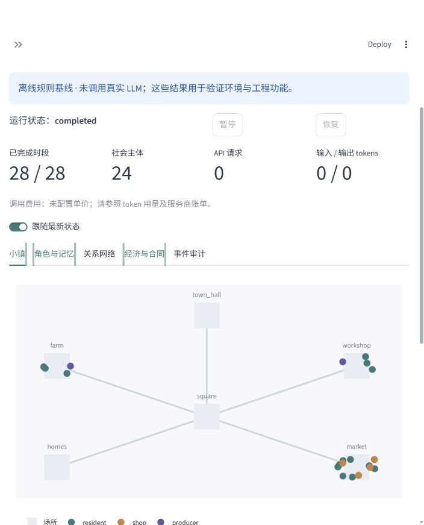

# Trustworthy Agent Simulation

[](https://github.com/apromisedland/trustworthy-agent-simulation/actions/workflows/ci.yml)

[中文说明](README.zh-CN.md) · [Architecture](docs/architecture.md) · [Scenario plugins](docs/plugins.md) · [Validation](docs/validation.md)

An auditable, configurable town society built on **AgentScope 2.0.9** and **Mesa 3.5.1**.
Residents and businesses exchange messages, remember events, seek employment,
work, produce goods, negotiate offers, execute escrow contracts, consume and
participate in community activities. Policies and production shocks change the
world through explicit resource accounting.

The default town has **18 residents, 4 shops and 2 producers**, with 7 days and
4 decision periods per day. A second public-goods plugin demonstrates scenario
extension without changes to the runner.

**Validation status:** offline environment tests and the real AgentScope tool
chain with controlled HTTP responses are included. No paid provider calls have
been performed for this release. Baseline output is explicitly labeled and is
not evidence of LLM behavior or real-world policy validity.



## Install

Python **3.12 or 3.13** is required; CI targets 3.12 on Windows and Linux. Run these
commands from the repository root. Dependencies are isolated and locked in
`uv.lock`; shell activation is unnecessary.

Windows PowerShell:

```powershell
py -3.12 -m venv .venv
.\.venv\Scripts\python.exe -m pip install uv==0.12.20
.\.venv\Scripts\uv.exe sync --frozen --extra dev --inexact
.\.venv\Scripts\python.exe -m tass.cli run --config configs/town.yaml --output runs/demo
.\.venv\Scripts\python.exe -m tass.cli dashboard
```

Linux:

```bash
python3.12 -m venv .venv
.venv/bin/python -m pip install uv==0.12.20
.venv/bin/uv sync --frozen --extra dev --inexact
.venv/bin/python -m tass.cli run --config configs/town.yaml --output runs/demo
.venv/bin/python -m tass.cli dashboard
```

Open [the local dashboard](http://127.0.0.1:8501). It includes a location map,
relationship network, agent state, recorded observations and memories, contracts, cash distribution,
economic indicators,
event audit and timeline replay. Dashboard workers use the same service as the
CLI. Pause takes effect after the current tick commits.

If `py`/`python` cannot be found or access is denied, locate and verify an existing
Python executable and invoke it by its absolute path. Do not install project
dependencies into a shared bundled runtime.

## Commands

The installed `tass` command is equivalent to `python -m tass.cli` using the project interpreter.

```text
tass validate --config configs/town.yaml
tass run --config configs/smoke.yaml --output runs/smoke
tass run --config configs/town.yaml --output runs/paused --max-ticks 3
tass run --resume runs/paused
tass pause runs/paused
tass replay runs/demo --tick 10
tass run --config configs/public_goods.yaml --output runs/public-goods
tass batch --config configs/town.yaml --output runs/policies --suite policy --seeds 11,22,33
tass batch --config configs/town.yaml --output runs/ablations --suite ablation --seeds 11,22,33
tass dashboard --runs-dir runs --port 8501
```

Run directories cannot be silently overwritten. Resume loads the exact saved
configuration, RNG states and completed decisions. Replay only reads committed
snapshots and never calls a model. Tick `-1` is the initial state; tick `0` is the
state after the first period.

## Connect a real model

Copy `.env.example` to `.env` and set `TASS_API_KEY`, `TASS_BASE_URL` and
`TASS_MODEL`. Choose a Chat Completions compatible endpoint with tool calling.
Credentials are read from environment variables, never from YAML or the dashboard.

```text
tass run --config configs/smoke.yaml --mode llm --output runs/llm-smoke
```

This command makes real provider requests. All shipped YAML files default to
`baseline`; no API is used by installation, validation, offline runs or replay.
Per-role models can be configured using `role_models.resident`, `.shop` and
`.producer`, each with its own `base_url`, `model` and `api_key_env`.

The default budget is **500 requests, 1,000,000 input tokens and 100,000 output
tokens**, including retries. Before each attempt the transport reserves a
conservative input estimate and maximum output; provider usage replaces the
reservation when reported. Missing usage and interrupted requests retain their
reservations. Costs are shown only when prices are configured; they are estimates,
not provider billing data. Token estimation is conservative rather than an exact
provider tokenizer. Budgets survive resume and are shared across a batch matrix.

Unavailable credentials fail before any request. Model failures are logged and
never replaced with baseline actions. Budget exhaustion stops at the last committed
world state; partially collected decisions remain available for audit. Resume
does not increase the original budget.

## Experiments and artifacts

- `policy`: no intervention, subsidy, source disclosure, and their combination.
- `ablation`: full provenance memory, no communication, no persistent memory,
  and ordinary event-summary memory.
- Each condition uses the same initial seeds. `runs.csv` contains one row per
  independent run; `summary.json` and `paired_effects.json` report means, standard
  errors and Student-t 95% intervals. One run does not yield an interval.
- Rules are not instructed to favor a policy. Baseline policies need not reproduce
  the behavior of a real model; memory conditions use the same event limit but
  are **not guaranteed to have identical token counts**.

Each run stores `run.sqlite` (authoritative transaction log and checkpoints),
`events.jsonl`, `metrics.csv` and `run.json`. The database also holds model request
bodies, responses, native AgentScope traces, exact pre-decision observations and durable action proposals. API
headers are not stored, and the configured key is redacted from provider records.
All run output and `.env` files are ignored by Git.

## Test and build

```text
uv run --frozen pytest -q
uv run --frozen ruff check src tests
uv run --frozen ruff format --check src tests
uv build
```

Tests cover escrow, refunds, stock conflicts, payroll, finite subsidies, private
observations, message evidence, exact offline resume, checkpoint replay, plugin
execution, budget persistence and actual AgentScope tool dispatch through a
controlled provider. CI does not need credentials.

## Reuse and research boundaries

[AgentScope](https://github.com/agentscope-ai/agentscope) supplies agent reasoning,
tool registration, model adapters, context handling and middleware/events.
[Mesa](https://github.com/mesa/mesa) supplies actors, seeded activation, network
space and data collection. Project-specific code implements economic rules,
visibility, evidence memory, durable accounting and experiment workflows.

The town is a synthetic research environment with finite resources, two goods,
discrete locations and simplified labor. It does not simulate an entire economy,
calibrate agents to human populations or establish real policy effects. The first
release is a local research app, not a hosted multi-user service.

Original research materials remain in the repository; downloaded source papers
and generated Word/PDF files remain local. See [NOTICE](NOTICE) for upstream
attribution. Code is licensed under [Apache-2.0](LICENSE).
