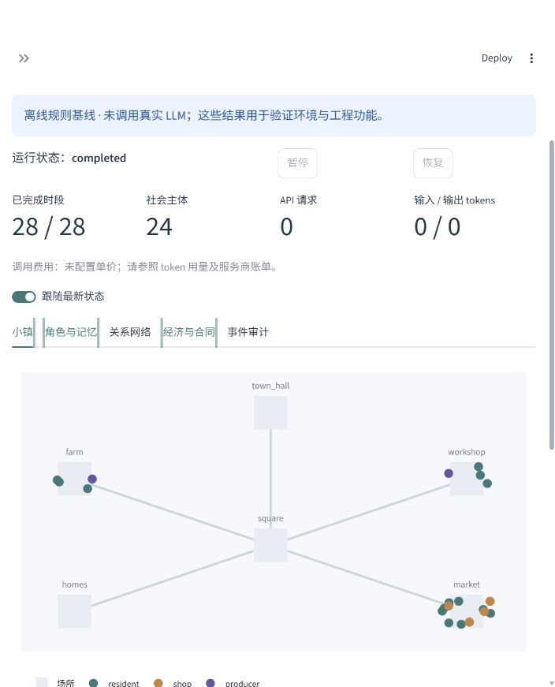

# 可信 LLM 多智能体小镇社会模拟

本项目基于 **AgentScope 2.0.9＋Mesa 3.5.1** 二次开发。AgentScope 负责 LLM 推理、工具调用、模型适配和上下文；Mesa 负责主体管理、随机调度、空间网络和指标采集。新增代码实现社会经济规则、局部信息、来源记忆、审计和实验流程。

默认小镇有 **18 名居民、4 家商铺、2 家生产企业**，运行 **7 天，每天 4 个时段**。居民可以移动、交流、求职、工作、购物、消费和参加社区活动；企业可以招聘、生产、报价及履行合同。另有公共品协作插件，用于验证通用接口。

**当前验证边界：已提供离线环境验证和使用受控 HTTP 响应的真实 AgentScope 工具链测试。尚未使用付费模型 API 进行行为验证。** 仪表盘与输出文件明确标记 baseline、controlled-provider 和 live-provider，不能把规则基线当作 LLM 实验结果。



## Windows 本地启动

在仓库根目录执行，无须激活虚拟环境：

```powershell
py -3.12 -m venv .venv
.\.venv\Scripts\python.exe -m pip install uv==0.12.20
.\.venv\Scripts\uv.exe sync --frozen --extra dev --inexact
.\.venv\Scripts\python.exe -m tass.cli run --config configs/town.yaml --output runs/demo
.\.venv\Scripts\python.exe -m tass.cli dashboard
```

浏览器打开 <http://127.0.0.1:8501>。如果 `py` 或 `python` 查找失败，请指定已经验证的 Python 绝对路径；访问拒绝与缺少解释器是不同问题。项目依赖仅安装在项目独立环境中。

Linux 使用 `python3.12` 创建环境，将命令中的 `.venv\Scripts\python.exe`、`.venv\Scripts\uv.exe` 分别替换为 `.venv/bin/python`、`.venv/bin/uv`。

## 运行与回放

以下 `tass` 可替换为 `.\.venv\Scripts\python.exe -m tass.cli`：

```text
tass validate --config configs/town.yaml
tass run --config configs/smoke.yaml --output runs/smoke
tass run --config configs/town.yaml --output runs/paused --max-ticks 3
tass run --resume runs/paused
tass pause runs/paused
tass replay runs/demo --tick 10
tass run --config configs/public_goods.yaml --output runs/public-goods
tass batch --config configs/town.yaml --output runs/policy --suite policy --seeds 11,22,33
tass batch --config configs/town.yaml --output runs/ablation --suite ablation --seeds 11,22,33
```

仪表盘提供实验启动、暂停、恢复、小镇位置、关系网络、角色私有状态、实际观察、记忆、合同、居民现金分布、指标和时间回放。角色只能看到权限允许的局部观察；研究者的审计视图可查看完整世界。暂停在当前时段提交后生效，恢复保持配置、预算、随机状态和已记录决策不变。

## 接入真实 LLM

复制 `.env.example` 为 `.env`，填写兼容工具调用的服务地址 `TASS_BASE_URL`、模型名 `TASS_MODEL` 和密钥 `TASS_API_KEY`。无需在代码中修改服务商。之后执行：

```text
tass run --config configs/smoke.yaml --mode llm --output runs/llm-smoke
```

此命令会产生真实 API 调用。当前交付不执行该命令。默认上限为 **500 次请求、100 万输入 token、10 万输出 token**；包含重试，并在调用前预留保守额度。服务未返回 usage 时保留估计额度。批量实验共享总预算，恢复不会重置预算。缺少密钥时明确报错，模型调用失败时不替换为规则策略。

所有示例默认采用离线 baseline。`role_models` 可为 resident、shop、producer 分别设置模型与密钥环境变量。费用需要自行配置单价，输出为估算值。

## 实验与证据

- 政策矩阵：无干预、消费补贴、来源披露、补贴与披露组合。
- 消融矩阵：来源记忆、普通事件摘要、无持久记忆、无通信。
- `runs.csv` 以完整独立运行为一行；`summary.json` 和 `paired_effects.json` 给出均值、标准误与运行层级的 95% t 区间。
- 同一种子共享初始条件，LLM 重采样不保证逐字一致；回放不重新调用模型。
- 普通摘要和来源记忆使用相同事件数量上限，实际 token 长度仍可能不同，正式研究需另做预算匹配。

每个运行目录包含 SQLite 事件、检查点、决策与模型调用记录，以及 JSONL/CSV 导出。资金使用整数最小货币单位；生产、消费、工资与政策支出都有记录。合同先托管货款与商品，交付后结算，超时退回。运行文件、密钥、下载的论文全文与渲染中间文件均不会上传 GitHub。

更多细节见 [架构](docs/architecture.md)、[插件接口](docs/plugins.md)、[验证说明](docs/validation.md)。当前是合成社会机制研究平台，尚未做人类行为校准，也不构成真实政策预测工具。
