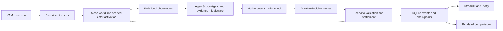

# Architecture and behavioral contract

## Runtime

`ScenarioConfig` is the versioned configuration. `AgentProfile`, `Observation`,
`Action`, `Decision` and `Event` are Pydantic contracts. Entry points in the
`tass.scenarios` group provide plugins through `ScenarioPlugin`.

A Mesa actor owns its private profile, cash, inventory, needs, employer,
location, trust and memories. The AgentScope agent is reconstructed for each
bounded turn with those explicit memories. Hidden chat history is not carried
between turns, so the no-memory ablation cannot accidentally retain an old
conversation. AgentScope still manages the within-turn ReAct context, tool
execution, permissions, middleware and native event stream.

Each tick applies external events, freezes all local observations, obtains
proposals with bounded concurrency, then uses Mesa's seeded AgentSet shuffle
to resolve them. A participant's ordered actions remain together. Conflicting
proposals can be rejected during settlement. New speech is available at the
next tick. A tool response saying "queued" is not a successful world action.

## Town economics

Time is discrete; each action is bounded by the per-tick action budget. A resident
may work once per tick, after reaching the employer's workplace. A resident can
move along one location edge per tick. Market offer, acceptance and delivery
tools operate remotely. Businesses are represented by decision-making actors;
their permanent workplace is their `home` location.

Money is integer cents. There is no credit or negative balance. Initial agent
balances plus a finite treasury define the initial money supply. The ledger
records every transfer as a debit and credit, including wages, deposits, contract
settlement, refunds and subsidies. Global money including escrow must remain
constant. Production creates declared inventory; consumption removes declared
inventory. Pending contracts hold reserved goods outside seller inventory.

A seller posts an expiring offer. A buyer accepts a quantity at the posted price,
which is the second party's consent. Acceptance reserves both stock and payment.
The seller can deliver through the deadline; otherwise the next tick refunds
money and stock. Repeated settlement and unauthorized delivery are rejected.
Payment is guaranteed by escrow; the first release therefore studies commitment
delays and failed delivery, not unsecured credit losses.

Production consumes accumulated paid labor. Farms produce food and workshops
produce household goods. A configured shock reduces output per labor unit for
specified whole days. Residents acquire one unit of unmet food need at each day
start, relieved by consumption. The consumption metric counts both goods;
unmet needs specifically measures food. No utility or welfare score is claimed.

Initial employment makes the market operable immediately; further employment
requires a worker's application and the firm's acceptance. There is no firing,
housing market, banking, births or deaths in this release.

## Information and memory

Agents see their own state, public offers/vacancies/activities, private contract
state, reachable contacts, and authorized observations. Other participants'
cash, preferences and private messages are not exposed. The dashboard is an
explicit researcher audit view and has broader visibility.

Events are classified as direct observations, hearsay or inference. A received
message remains hearsay even when its sender claims authority. Reflections are
inferences. Evidence IDs must belong to events already visible to the sender.
Without source disclosure, message evidence references and the sender's claimed
source class are hidden from participant views but retained in the audit log.
Source disclosure exposes these fields and requires evidence for claimed direct reports.
Trust changes only from personally observed fulfillment/expiry outcomes and
is never treated as proof of truth. Messages and reflections cannot execute code.
No shell, filesystem, browser or payment tools are registered with the agents.

Up to 200 authorized events are retained per actor; the latest configured event
limit is retrieved. Ordinary memory strips the event envelope into short event
summaries; provenance memory retains source information. No-memory mode removes
persistent memories and trust from observations while preserving current
feedback, commitments and resource state.

## Persistence and failure handling

One OS-level lease protects each run. SQLite WAL allows the dashboard to read
while the worker writes. Exact local observations are journaled before decisions;
decisions are journaled before resolution. The events,
resulting world state and metrics for a tick commit in one transaction.
Python and NumPy RNG states and actor order are included in checkpoints.

If interrupted before commit, the world returns to the previous checkpoint;
already stored decisions are reused. Completed HTTP responses can be reused
when the exact request body recurs during recovery. A request interrupted before
its response is durably recorded may have reached the provider; its reserved
usage remains charged, and a later retry may be another billable request.
This cannot be eliminated without provider-side idempotency.

The provider transport records every actual HTTP attempt, including retries.
SDK/framework retries are disabled so there is one retry policy. Input budget
reservation uses request bytes plus a safety allowance; maximum output is reserved
before dispatch. Returned usage replaces reservations. This is a conservative
operational limit, not a guarantee about an external provider's billing or
tokenizer behavior. Missing usage stays estimated. Costs use configured prices.

The model has a bounded ReAct loop. Invalid or absent proposals produce a failed
decision, not a hidden baseline action. At budget exhaustion the tick is not
committed. Pause finishes the current tick. Configuration and budget changes
require a new run; resume preserves the original experiment.

## Measurements

Economic metrics include resident cash, cash Gini, employment count, consumption,
food needs, contracts, fulfillment, trade volume, seller-revenue HHI and fiscal
spending. Contract rates omit unresolved contracts; a zero-denominator rate is
null. Cash Gini excludes firm balances and is not a net-wealth measure. HHI uses
all completed sales, including wholesale transactions. Message/invalid-action
counts are per tick; consumption and trade volume are cumulative.

Policy and ablation batches use complete independent runs as samples, matched
on initialization seeds. Means, standard errors and Student-t intervals are
descriptive small-sample summaries; low seed counts are not confirmatory evidence.
Paired effects subtract the first condition at the same seed. Incomplete runs
remain on disk but are excluded from final-run comparisons. Live batches share
the configured total API budget across their constituent runs.
